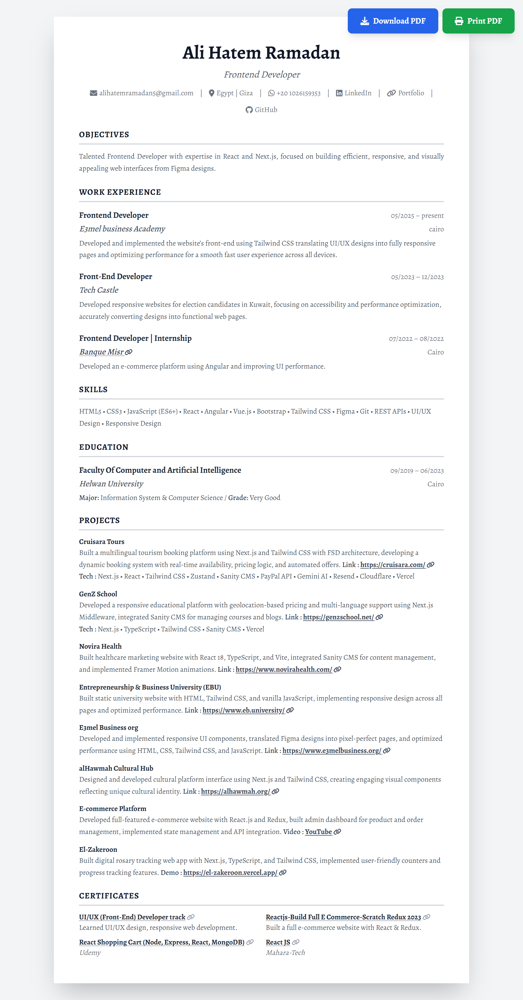
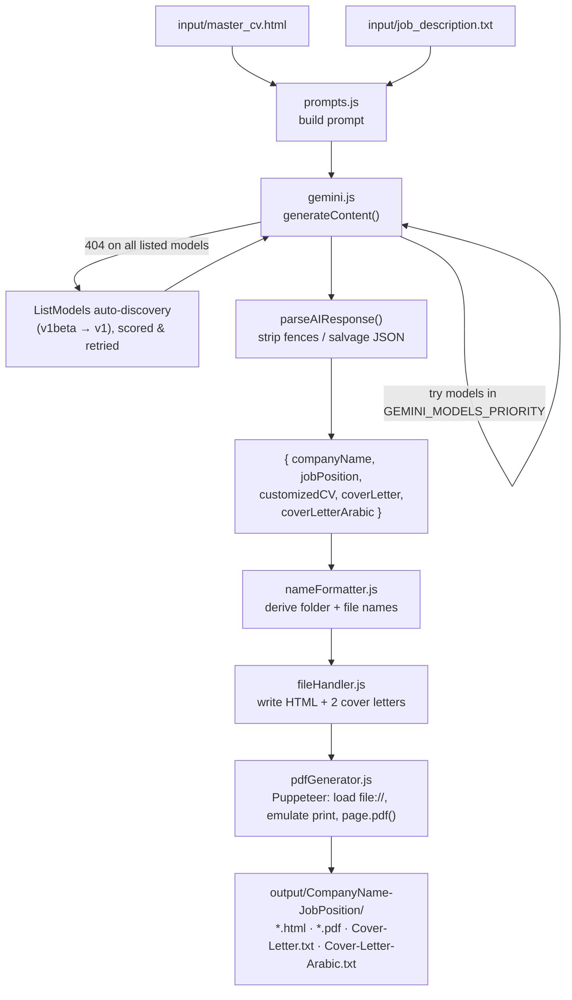

# 🚀 AI-Powered Custom CV Generator

**منشئ السيرة الذاتية المخصص والتلقائي باستخدام الذكاء الاصطناعي**

A single-shot Node.js CLI that reads your master CV and a job description, sends both to **Google Gemini**, and writes back a tailored CV (HTML + text‑based PDF) plus an English and an Arabic cover letter — ready to submit.

One command, one job application package.

---

## 📸 Screenshot

Generated CV output (HTML rendered to PDF), from an actual `npm start` run:



---

## ✨ Features

- 🎯 **ATS-aware customization** — rewrites the summary and reorders skills/keywords to match the job description, without inventing experience
- 💼 **Dual cover letters** — one in English, one in Arabic, generated in the same pass
- 📄 **Text-based PDF output** — renders the customized HTML with Puppeteer (`print` media emulation), so the PDF text stays selectable and ATS-parsable, not a flattened image
- 🔁 **Fallback-heavy model selection** — walks a priority list of Gemini models; on `404`s it auto-discovers whatever models your API key actually has access to via `ListModels` and ranks them, so the tool keeps working even after model names change
- ⏳ **Resilient to transient failures** — exponential-backoff retries on `503`, automatic downgrade of `generationConfig` on unsupported MIME-type / max-token errors, immediate abort on invalid API keys
- 🧹 **Forgiving JSON parsing** — strips code fences and salvages JSON even when the model wraps its answer in extra text
- 📁 **Self-organizing output** — folders and filenames are derived from the AI-detected company + position (`CompanyName-JobPosition/`), no manual naming
- 🎨 **Design-preserving** — the AI is instructed to keep your original Tailwind CSS/HTML structure and print rules, and only change text content

---

## 🏗️ Architecture



---

## 📋 Prerequisites

- [Node.js](https://nodejs.org/) (v18 or higher — needed for global `fetch`, used by model auto-discovery)
- [Google Gemini API Key](https://makersuite.google.com/app/apikey)

---

## 🛠️ Installation

1. **Clone or download this project**

2. **Install dependencies**

   ```bash
   npm install
   ```

   This also downloads a bundled Chromium for Puppeteer — expect a larger first install.

3. **Set up your API key**

   Create/edit `.env`:

   ```
   GEMINI_API_KEY=your_actual_api_key
   ```

4. **Update your name** in `config/config.js`:
   ```javascript
   USER: {
     FULL_NAME: "Your Name", // Change this!
   }
   ```

---

## 📂 Project Structure

```
├── index.js                  # Pipeline entry point (Step 1..5, logs each stage)
├── config/
│   └── config.js             # API key, model priority list, paths, AI params
├── src/
│   ├── ai/
│   │   └── gemini.js         # Model fallback, auto-discovery, retries, JSON parsing
│   ├── utils/
│   │   ├── fileHandler.js    # File read/write
│   │   ├── nameFormatter.js  # Folder/CV filename derivation
│   │   └── pdfGenerator.js   # Puppeteer HTML → PDF
│   └── templates/
│       └── prompts.js        # The prompt — most product behavior lives here
├── input/
│   ├── master_cv.html        # Your master CV (gitignored copy read at runtime)
│   └── job_description.txt   # Job post to apply for (gitignored)
├── MASTERS/                    # Hand-maintained source CVs per role (gitignored)
├── output/                     # Generated packages, one folder per application (gitignored)
├── .env                        # GEMINI_API_KEY (gitignored)
└── package.json
```

---

## 🚀 Usage

### Step 1: Prepare your master CV

Copy the variant that matches the role from `MASTERS/` (e.g. `master_cv.html`, `fullstack_cv.html`, `react_native_cv.html`) into `input/master_cv.html`, or edit it directly with your complete CV information. It's plain HTML styled with Tailwind CSS.

### Step 2: Paste the job description

Paste the full job post — requirements, responsibilities, company info — into `input/job_description.txt`.

### Step 3: Run the generator

```bash
npm start
```

or, with auto-reload while iterating on the prompt:

```bash
npm run dev
```

### Step 4: Collect your files

```
output/CompanyName-JobPosition/
├── YourName-JobPosition.html      # Customized CV (HTML)
├── YourName-JobPosition.pdf       # Same CV, selectable-text PDF
├── Cover-Letter.txt               # English cover letter
└── Cover-Letter-Arabic.txt        # Arabic cover letter
```

---

## 📖 Example

**Input** — `input/job_description.txt` (excerpt from a real run):

```text
Ejadah Management Consultancy
Full Stack Engineer (Fresh Graduate - Saudi)
Riyadh, Saudi Arabia · On-site · Full-time

Who we're looking for
A fresh graduate or recently unemployed developer who cares about how things
look and feel as much as how they work. You are comfortable in React.js, have
an eye for good UI, and want to grow fast inside a real product team.

Required
- Strong knowledge of React.js — the most important technical requirement
- Degree in Computer Science, Software Engineering, or related field
...
```

**Command:**

```bash
npm start
```

**Terminal output:**

```text
🚀 AI-Powered CV Generator Started
==================================================

📋 Step 1: Validating configuration...
   ✅ Configuration valid

📂 Step 2: Reading input files...
   ✅ Loaded master CV (5312 characters)
   ✅ Loaded job description (2140 characters)

🤖 Step 3: Generating customized content...
🤖 Sending request to Gemini AI...
   🤖 Trying model: gemini-2.5-flash...
   ✅ Success with model: gemini-2.5-flash
📝 Parsing AI response...
   ✅ Company detected: Ejadah Management Consultancy
   ✅ Position detected: Full Stack Engineer (Frontend Focus)

💾 Step 4: Saving generated files...

📑 Step 5: Generating PDF (Text-based)...
   🌐 Launching browser...
   📄 Loading HTML file...
   🖨️ Generating PDF...
   ✅ PDF created: Ali-Hatem-Ramadan-FullStackEngineerfrontendFocus.pdf

==================================================

✨ SUCCESS! Files generated successfully!

📁 Output folder: output/Ejadah-FullStackEngineerfrontendFocus
📄 CV (HTML): Ali-Hatem-Ramadan-FullStackEngineerfrontendFocus.html
📄 CV (PDF): Ali-Hatem-Ramadan-FullStackEngineerfrontendFocus.pdf ✨ Selectable Text!
📝 Cover Letter (EN): Cover-Letter.txt
📝 Cover Letter (AR): Cover-Letter-Arabic.txt

🎯 Next steps:
   1. Use the PDF file for job applications
   2. Copy the cover letter for your application
```

**Output** — `Cover-Letter.txt` (excerpt, generated for the run above):

> I am writing to express my enthusiastic interest in the Full Stack Engineer (Frontend Focus) position, as advertised on LinkedIn. As a recent Computer Science graduate from Helwan University with a "Very Good" grade and a strong foundation in React.js and modern frontend development, I am precisely the fresh graduate you are seeking—someone who cares deeply about how things look and feel as much as how they work...

---

## ⚙️ Configuration

Edit `config/config.js` to customize:

```javascript
export const CONFIG = {
  USER: {
    FULL_NAME: "Your Name",
  },

  // Tried in order; on a 404 across the whole list the tool auto-discovers
  // models available to your API key instead. Prefer adding new aliases at
  // the top over deleting old ones.
  GEMINI_MODELS_PRIORITY: [
    "gemini-2.5-flash",
    "gemini-2.5-flash-lite",
    // ...
  ],

  AI_SETTINGS: {
    TEMPERATURE: 0.5, // Creativity (0.0 - 1.0)
    MAX_OUTPUT_TOKENS: 32768,
  },
};
```

Everything about *how* the generated CV looks and reads (2-line summary, no bullet points in Experience, which sections get dropped, anti-hallucination rules, the signature block) lives in the prompt at `src/templates/prompts.js`, not in code.

---

## 📝 Tips

1. **Keep your master CV comprehensive** — include every role, skill, and project. The AI selects and reorders; it doesn't invent.
2. **Paste the complete job description** — requirements, responsibilities, and company context all feed the customization.
3. **Review before sending** — always proofread the generated CV and cover letters before submitting.
4. **Preserve the print CSS classes** if you edit the CV template — `.print-atomic`, `.allow-break`, `.print-tight`, and the `@media print` block control how the PDF paginates.

---

## 🤝 Contributing

Feel free to submit issues and pull requests!

---

## 📄 License

MIT License
